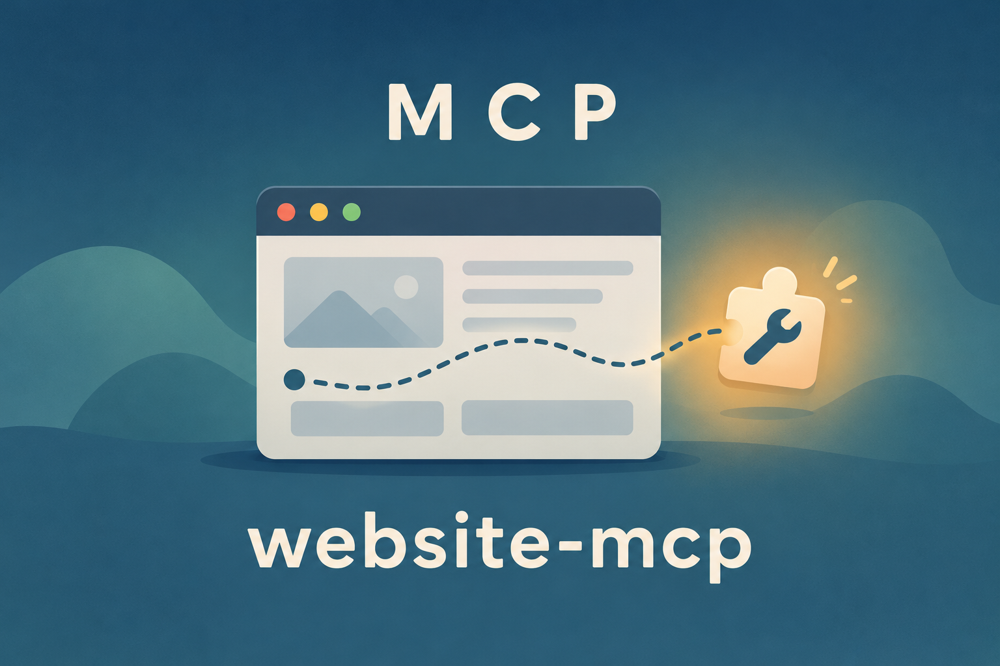

<!--
GitHub metadata, authored here and applied by hand in repo Settings (not rendered on the page):
About:  Mint any website task into a tested, deterministic MCP tool with Claude Code, then replay it with no model — Playwright browser tools plus page tools that run in your own Chrome tab.
Topics (ranked): mcp, model-context-protocol, claude-code, claude-code-plugin, browser-automation, playwright, web-scraping, chrome-extension, native-messaging, mv3, deterministic, tool-generation, typescript, nodejs, cli
Social preview: docs/media/hero.png at 1280x640 once the asset exists.
-->

# website-mcp — Website to Deterministic MCP Tool

**Explore a site once. Replay it forever, free.**  
*Claude Code writes and tests a script for a site task, saves it as an MCP tool, and from then on it runs with no model in the loop.*


<!-- HERO IMAGE PLACEHOLDER:  — keep commented out until the asset exists. -->

You type `/website-mcp:mint <task> on <site>`. Claude explores the site, writes a script, proves it against test cases, gets it reviewed, and saves it as a tool. After that the tool is a plain file: it runs instantly, costs nothing, and gives the same answer shape every time.

## The map

| I want to… | Tool kind | What it is |
|---|---|---|
| **Read a public site** unattended | Browser tool ([`src/browser/`](src/browser/)) | Runs in a fresh Playwright browser, blocked from any origin outside the tool's allow-list |
| **Read or fill a signed-in site** | Page tool ([`extension/`](extension/)) | Runs inside a tab of your own Chrome, after you allow the site and approve the tool version |
| **Change something** on a site | Write tools ([`authoring/writes.md`](authoring/writes.md)) | Rehearsal by default; page tools never press the final Save, you do |
| **Swap the minter** | Model seam ([`docs/model-seam.md`](docs/model-seam.md)) | The interfaces a local model or API would implement |

## Quick start

Needs Node 22+ and Claude Code. Chrome is the supported browser for page tools.

```bash
npm install && npm run build
claude plugin marketplace add .
claude plugin install website-mcp@website-mcp
```

1. **Mint a tool** — in Claude Code run `/website-mcp:mint <what to read> on <site url>`; pick "browser" for public sites.
2. **Run it anywhere** — `node dist/cli.js run <name> --input '{"q":"..."}'` from the checkout (or `npm link` once, then plain `website-mcp run …`), or call it as an MCP tool. Below, `website-mcp` means either form.

The local marketplace above loads the checkout in place. A marketplace added from a GitHub URL has no `dist/`: set `WEBSITE_MCP_ALLOW_NPX=1` (runs the published npm package) or `WEBSITE_MCP_ROOT` (path to a built checkout). Details in [`plugin/README.md`](plugin/README.md).

Browser tools work now. Page tools need one more setup, below. That's it for the basics; everything below is detail.

---

## Demo

Output of the test suite (`test/browser`) running a saved tool against the repo's local fixture site (`test/fixtures/site/`), no model involved. It is not a command you can paste from a fresh checkout: the fixture server and origin are set up by the tests.

```
$ website-mcp test fixture_search
case          result  ms     error
tag_alpha     PASS    174
tag_beta      PASS    162
tag_gamma     PASS    163
no_match      PASS    161
blank_query   PASS    116
empty_string  PASS    1

6/6 passed (100%); bar: >=3 cases and >=70% -> OK

$ website-mcp run fixture_search --input '{"q":"alpha"}'
{
  "items": [
    "Fixture item 01",
    "Fixture item 06",
    "Fixture item 11",
    "Fixture item 16",
    "Fixture item 21"
  ]
}
```

---

## Page tools setup (your own Chrome)

Page tools run in your real, signed-in tab, so they need the extension and a native-messaging bridge.

1. **Load the extension** — open `chrome://extensions`, turn on Developer mode, choose "Load unpacked" and pick the `extension/` folder.
2. **Allow User Scripts** — on the extension's details page, turn on **Allow User Scripts**. Without it the extension cannot run tool code.
3. **Install the bridge** — `node dist/cli.js bridge install --browser chrome` (or `website-mcp bridge install …` after `npm link`), then restart Chrome.
4. **Check** — `website-mcp bridge status` should report the host installed and the extension connected.
5. **Grant and approve** — in the extension popup, click **Allow this site** for each site, and **Approve** for each tool version. Changing a tool's code asks again.

---

## Draft, test, publish

Minting goes through a draft folder, never straight into `tools/`:

1. **`save_tool`** writes the draft `tool.json` and `tool.mjs`.
2. **`save_cases`** writes at least 3 cases, including an empty and an `invalid_input` one.
3. **`test_tool`** runs them through the normal runtime, no model.
4. **`publish_tool`** re-checks a staged copy and publishes only if the bar is met: at least 70% of cases pass, valid schemas, no secret-shaped literals, no URL outside the allow-list, and a declared `effect`.

The previous version moves to `.history/<n>/`. Commands: `serve`, `list`, `run`, `test [--draft]`, `review`, `publish`, `bridge install|status|uninstall`.

---

## Safety

A page tool is model-written code running in your signed-in tab, so read [`docs/safety.md`](docs/safety.md). In short: the static scan is not a sandbox; what protects you is the per-site grant, the per-version approval bound to the executed code, the explore window, and, for writes, you pressing the final button. The page also covers site terms and what is and is not a boundary.

> **Heads up:** a tool you mint acts as you. Check a site's terms before pointing a tool at it.

---

## Status

Phases 1 to 8 are built (see [`CHANGELOG.md`](CHANGELOG.md)). Not yet: a Chrome Web Store listing, a local-model minter, auto-repair. Prior art and what was and was not borrowed: [`docs/prior-art.md`](docs/prior-art.md).

## License

MIT, see [LICENSE](LICENSE).
